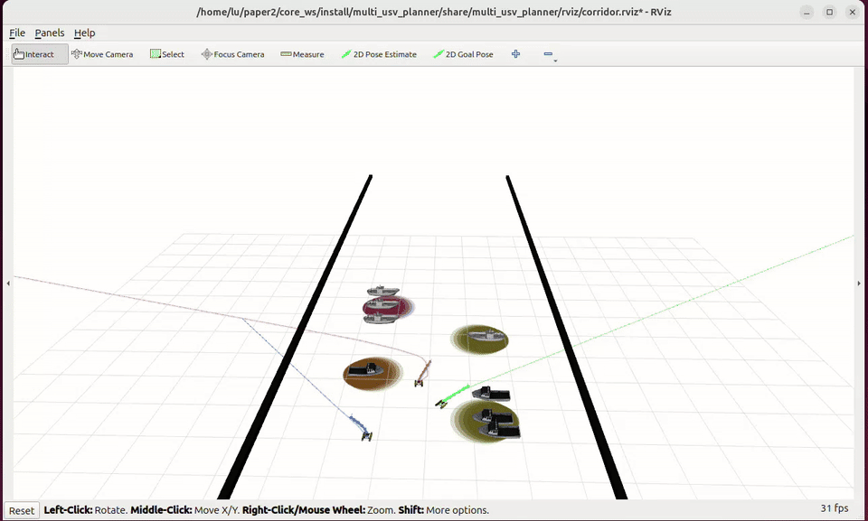
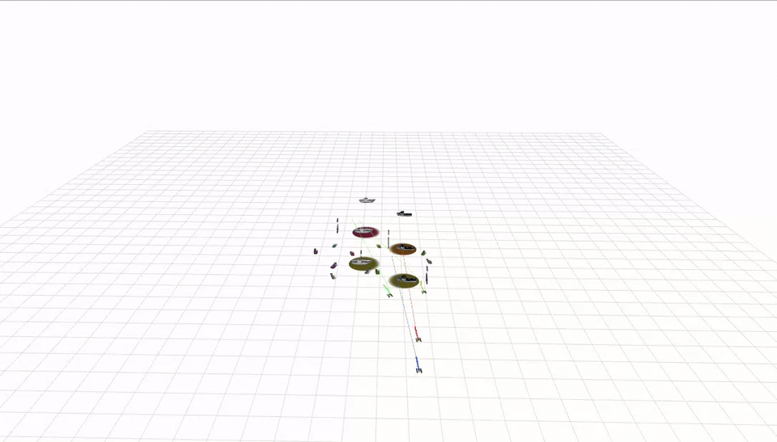
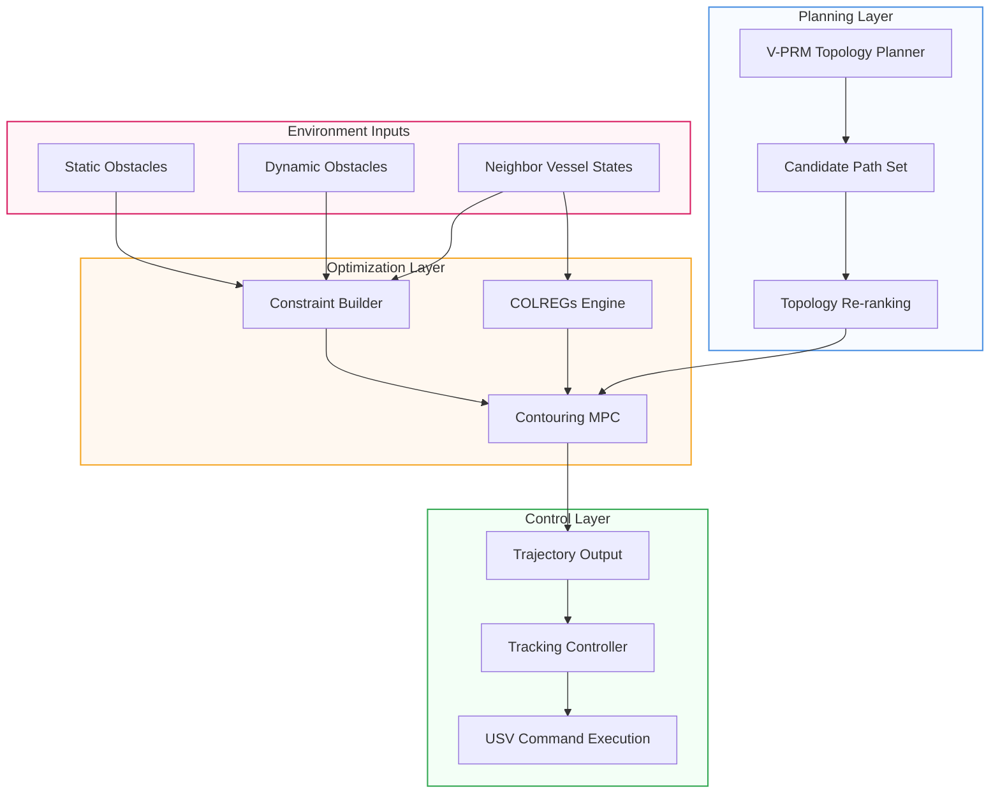

[](LICENSE)


# Multi-USV DITO Planner

A **multi-USV cooperative collision avoidance planner** integrating contouring MPC, V-PRM topology-driven path selection, and COLREGs-compliant navigation in ROS 2 Humble.

| Corridor Scenario Evaluation |
| ---------------------------- |
|  |

| Stretched Open-Water Scenario Evaluation |
| ---------------------------------------- |
|  |

**Note on the second demonstration.** Some collisions in the second scenario are caused by abruptly appearing floating-debris models. Those events are not practically avoidable once the obstacle appears with insufficient reaction time. Despite that limitation, the overall behavior remains stable and the cooperative navigation performance is still satisfactory.

---

## Table of Contents
1. [Features](#features)
2. [System Architecture](#system-architecture)
3. [Installation](#installation)
4. [Usage](#usage)
5. [Configuration](#configuration)
6. [Dependencies & Acknowledgments](#dependencies--acknowledgments)
7. [License](#license)
8. [Citing](#citing)

## Features

- **Multi-USV Coordination** — Inter-vessel state exchange and cooperative collision avoidance.
- **COLREGs Compliance** — Implements Rules 14 (head-on), 15 (crossing), 16 (give-way), and 17 (stand-on) through behavior-aware speed modulation.
- **V-PRM Topology Planning** — Generates multiple distinct topological trajectories online and re-ranks them before execution.
- **Contouring MPC** — Solves real-time trajectory optimization with **acados**, ellipsoidal obstacle constraints, and safe corridor support.
- **Dynamic Obstacle Handling** — Tracks moving vessels and floating debris for online collision avoidance.
- **Deadlock Prevention** — Includes stagnation detection and recovery behavior to prevent prolonged standstill.
- **RViz Visualization** — Provides per-vessel visualization of planned trajectories, topology candidates, and obstacle context.
- **Batch Experiment Pipeline** — Supports automated multi-episode evaluation for easy, medium, and hard scenarios.

## System Architecture



## Installation

### Prerequisites

- **ROS 2 Humble** (Ubuntu 22.04; Jazzy is also supported with the matching ROS dependencies)
- C++17 compiler
- Python 3.10+
- [acados](https://docs.acados.org/) v1.4+
- Eigen 3.4
- DecompUtil

### Build

```bash
cd core_ws
source /opt/ros/humble/setup.bash
colcon build --symlink-install
source install/setup.bash
```

### Acados Solver Setup

```bash
cd core_ws/src/multi_usv_planner
python3 scripts/generate_contouring_solver.py
```

Ensure that `ACADOS_SOURCE_DIR` and `LD_LIBRARY_PATH` point to a valid acados installation.

## Usage

### Launch the Main Multi-USV Scenario

```bash
ros2 launch multi_usv_planner planner_corridor.launch.py
```

### Launch the Stretched Open-Water Scenario

```bash
ros2 launch multi_usv_planner planner_spaced_scene.launch.py
```

The spaced-scene demo is the recommended presentation view. It uses an Orbit camera, a restrained grid, three moving USVs by default when `MULTI_USV_AGENTS=3` is set, dynamic vessels, topology candidate paths, and low-profile cylindrical static obstacles. The old `ice_floes.glb` mesh remains available through `use_static_mesh:=true`, but is disabled by default because its mesh origin makes the scene look like a lifted ice sheet in RViz.

```bash
cd core_ws
source /opt/ros/humble/setup.bash
source install/setup.bash
MULTI_USV_AGENTS=3 ros2 launch multi_usv_planner planner_spaced_scene.launch.py \
  use_rviz:=true use_guidance:=true use_models:=true
```

默认展示场景使用 3 艘 Heron USV 和 4 艘横向穿越的动态船只；如需压力测试，可设置 `MULTI_USV_DYNAMIC_COUNT=6`。动态障碍物的预测安全圈使用稳定的 RViz marker ID，并保留短暂的消息延迟，不会因单帧通信抖动而闪烁消失。

### Run Batch Experiments

```bash
cd core_ws
python3 src/multi_usv_planner/scripts/run_corridor_experiments.py
```

### Single-USV Mode

```bash
ros2 launch multi_usv_planner planner_single.launch.py
```

## Configuration

Key configuration files are located in `core_ws/src/multi_usv_planner/config/`:

| File | Purpose |
|------|---------|
| `usv_params.yaml` | Default planner and controller parameters |
| `usv_params_easy.yaml` | Easy scenario parameters |
| `usv_params_medium.yaml` | Medium scenario parameters |
| `usv_params_hard.yaml` | Hard scenario parameters |
| `usv_params_no_soft_nb.yaml` | Variant configuration for ablation / comparison |

### Key Parameters

- `mpc.N` — MPC prediction horizon
- `mpc.dt` — Discretization time step
- `mpc.desired_speed` — Nominal cruising speed
- `mpc.obstacle_clearance` — Minimum obstacle clearance
- `colregs_enabled` — Enables COLREGs behavior logic
- `enable_topology_rerank` — Enables candidate topology re-ranking
- `episode_timeout_s` — Maximum scenario duration before timeout

## Dependencies & Acknowledgments

This project builds on open-source tools and prior robotics software. We gratefully acknowledge the following references and dependencies.

### Core Dependencies

| Dependency | Purpose | Source |
|-----------|---------|--------|
| [ROS 2 Jazzy](https://docs.ros.org/en/jazzy/) | Middleware and runtime | Open Robotics |
| [acados](https://docs.acados.org/) | Real-time nonlinear MPC solver | [acados GitHub](https://github.com/acados/acados) |
| [Eigen 3](https://eigen.tuxfamily.org/) | Linear algebra | Eigen Project |
| [DecompUtil](https://github.com/oscardegroot/DecompUtil) | Safe corridor decomposition | S. Liu et al. |

### Special Acknowledgments

1. **[mpc_planner](https://github.com/tud-amr/mpc_planner)** — Provided useful inspiration for the visualization style and topology-aware trajectory optimization workflow.
2. **[teb_local_planner](https://github.com/rst-tu-dortmund/teb_local_planner)** — Offered valuable reference for dynamic trajectory optimization structure and constraint separation.
3. **[A-physical-simulator-for-ECA-A9](https://github.com/solelyman/A-physical-simulator-for-ECA-A9)** — Served as the starting point for parts of the controller-side simulation workflow.
4. **ClearPath Heron USV Model** — Provided the base USV dynamics and simulation reference used in this project.

## License

This project is licensed under the Apache 2.0 License — see the [LICENSE](LICENSE) file for details.

## Citing

If you find this work useful for your research, please consider citing:

```bibtex
@misc{multi_usv_planner2026,
  author = {Lu},
  title = {Multi-USV COLREGs Planner: Topology-Driven Cooperative Navigation for Unmanned Surface Vehicles},
  year = {2026},
  publisher = {GitHub},
  url = {https://github.com/solelyman/Multiple-agent-path-planning-and-optimization}
}
```
